# NestJS SaaS AI 客服系统（多租户）+ 管理前端


多租户 SaaS AI 客服平台：企业**自助注册开通** → 搭知识库 → 一行 `<script>` 把 AI 客服**挂件**挂到任意网站 → AI 依据知识库流式应答 → 知识同时输出为可 SEO 的**帮助中心**页面；平台方管理全部租户、会话与用量。
后端：细粒度权限中枢（接口/按钮/数据行三级）+ LangChain 1.x AI 基础设施（多厂商可切换、SSE 流式、用量审计）。
前端：[web/](./web) 基于 [art-design-pro](https://github.com/Daymychen/art-design-pro)（Vue3 + TS + Vite + Element Plus + Tailwind）精简改造，已完整对接后端权限体系。

## 特性

- 🏢 **多租户 SaaS**：租户自助注册（`/auth/register`，一次事务开通租户 + 管理员 + 角色）；`Tenant.ownerId` 锚定归属，登录守卫自动注入租户上下文，知识库/会话/API Key **服务端强制行级隔离**（越权按不存在处理）；平台侧全量视角，停用租户连带失效接入凭证
- 📚 **知识库 + TAG**：租户可建多个知识库，文章 Markdown 编辑、发布状态机、标签体系；中文重叠二元切片关键词检索（Top-N 注入 prompt，P2 可升级 pgvector 语义检索）
- 🔌 **网页挂件**：宿主网站一行 `<script src="平台/widget.js?k=sk-xxx">` 即挂载；iframe 隔离样式、访客 ID/会话本地持久续聊、SSE 流式、相关文章推荐、Key 失效友好提示
- 🔍 **C 端 SEO 帮助中心**：NestJS 直出 HTML（零模板引擎依赖），`/help/{租户}/{slug}` 带 canonical/OG/JSON-LD（Article + FAQPage 富摘要）、sitemap.xml、robots.txt；Markdown 渲染全程转义防 XSS，爬虫禁 JS 可读
- 🔐 **三级权限体系**：RBAC 权限码模型，粒度到接口（`@RequirePermissions`）、按钮（前端 `v-auth`）、数据行（`@DataScope` 部门树/本人/自定义范围）；前后端共用同一套权限码，角色改权限**无需重新登录**即时生效（Redis 精准失效）
- 🤖 **LangChain 1.x AI 基础设施**：`AiRegistry`（DB 模型配置 → ChatOpenAI/ChatOllama 实例）+ `AiGateway`（流式/主备降级/审计门面）+ `AiAgentService`（`createAgent` 工具循环 + 权限折叠）；mock 模型兜底本地联调；每次调用落 `ai_call_log` 审计（token 用量、成本、traceId 串联）
- 🧩 **模型配置化（参考 CC Switch）**：供应商/模型全部数据库驱动——「模型配置」页可视化增删改厂商（名称/协议格式/端点/API Key/启停）、模型（最大输出/上下文窗口/默认模型），支持从端点自动拉取模型列表（`/v1/models`、Ollama `/api/tags`）；保存即时生效，env 仅作首次引导兜底
- 🛠️ **Function Calling 工具调用 Agent**：AI 对话自动识别意图并调用真实系统工具（系统概览、搜索用户、**创建用户**、分配角色、查询角色/部门/权限点、**配置角色权限**、AI 用量），工具以 zod 声明、执行走真实权限码门控，写操作完成后发权限失效事件——对话里就能「查用户数、添加员工、配权限」
- 💬 **Open WebUI 风格对话**：会话侧栏（分组/搜索/重命名/删除）、Markdown + 代码高亮复制、消息编辑/重新生成/复制、模型选择器、快捷回复、打字指示、停止生成、快捷键（`Ctrl+Shift+O` 新对话 / `Ctrl+K` 搜索 / `Esc` 停止）；全局悬浮助手「米答」随时唤起
- 📊 **真实数据驾驶舱**：工作台（系统资源计数 + AI 用量指标 + 14 天趋势 + 最近调用）、用量报表（ECharts：KPI/趋势/Token 占比环图/模型与厂商柱状 + 明细表）全部由真实接口驱动，零 mock
- 🔔 **站内通知**：`sys_notification` 表 + 按用户隔离的通知接口，铃铛未读角标、单条/全部已读、清空已读；系统事件自动生成通知（如 AI 调用失败）
- 🧱 **统一横切**：统一响应包 `{code, message, data, traceId, timestamp}`、全局异常兜底（Prisma 错误归一化）、AsyncLocalStorage 全链路 traceId、结构化日志（pino）
- 🛡️ **安全默认**：JWT 双 Token（旋转 + 单点踢人）、argon2 密码哈希、登录/注册限流、helmet（挂件路由定点放开跨源限制）、DTO 白名单校验、配置 Joi 启动校验（Fail Fast）
- 🧰 **工程化**：ESLint 9 + Prettier + Stylelint、husky + lint-staged + commitlint、madge 循环依赖检查、Swagger（生产自动关闭）、Docker 多阶段构建、VS Code 四配置断点调试

## 页面预览

| 租户自助注册（开通工作空间）                    | 租户管理（API Key + 挂件代码一键复制）                |
| ----------------------------------------------- | ----------------------------------------------------- |
| 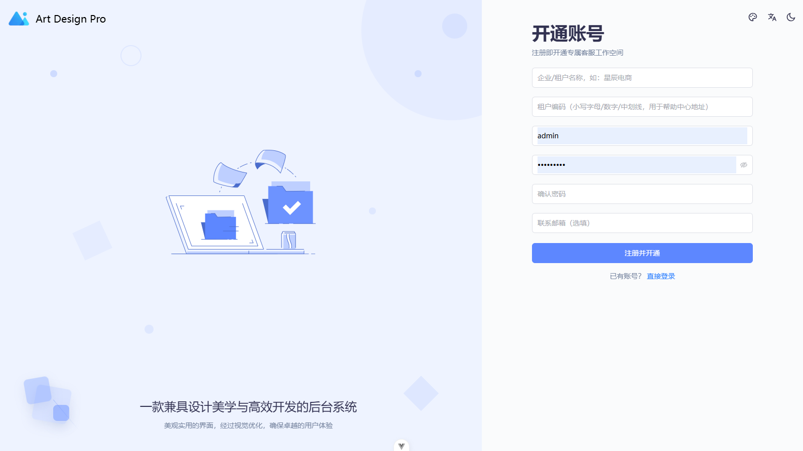   | 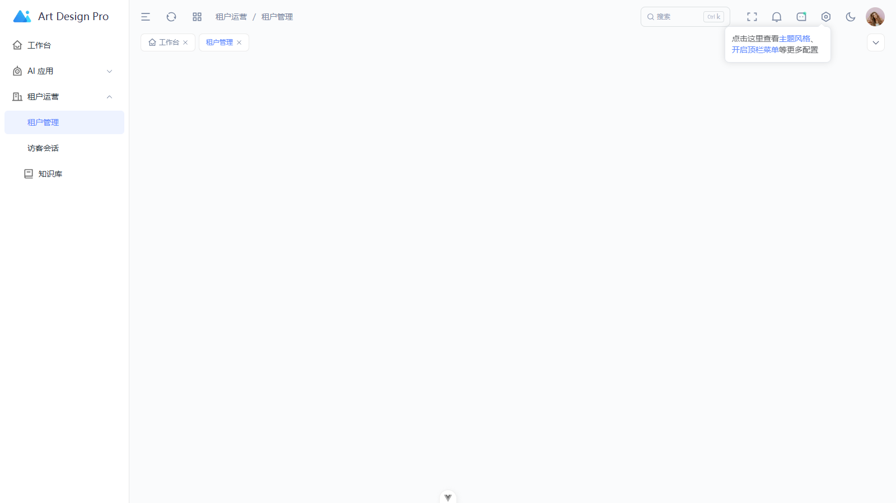       |
| **知识库（文章 + 标签 + SEO 字段）**            | **访客会话（AI 对话记录）**                           |
| 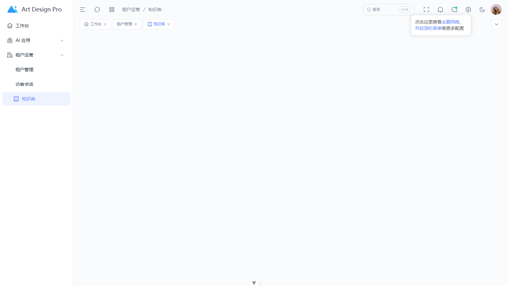       |  |
| **C 端帮助中心（SEO 直出页）**                  | **网页挂件（第三方网站一行 script）**                 |
| 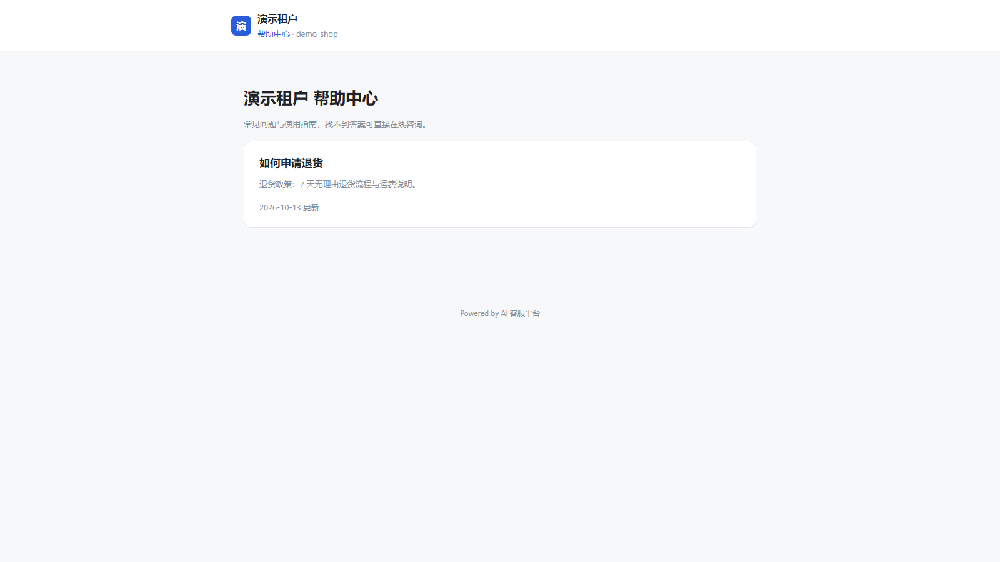 | 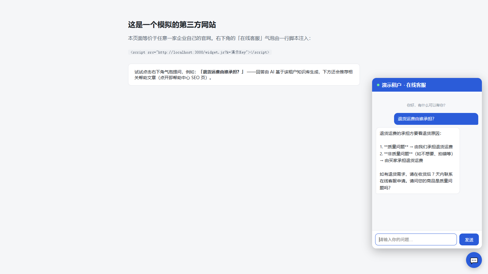           |
| **工作台（真实数据驾驶舱）**                    | **个人中心（自助资料 / 改密）**                       |
| 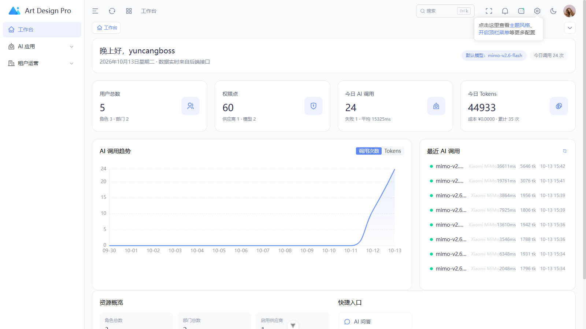     | 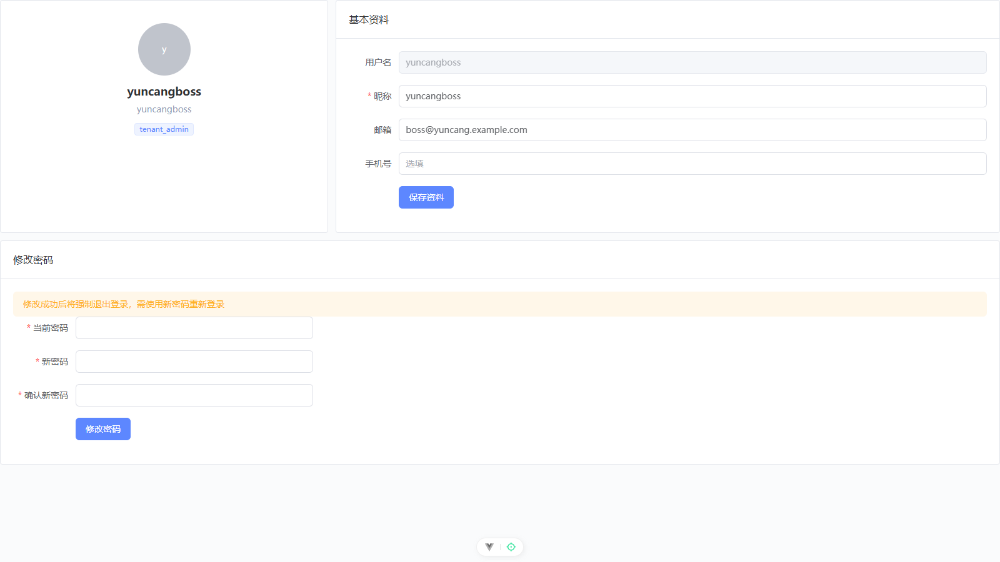       |

<details>
<summary>更多（AI 能力与登录）</summary>

| AI 问答（工具调用 Agent）                  | 模型配置（CC Switch 式）                      | 用量报表（ECharts）                          |
| ------------------------------------------ | --------------------------------------------- | -------------------------------------------- |
| 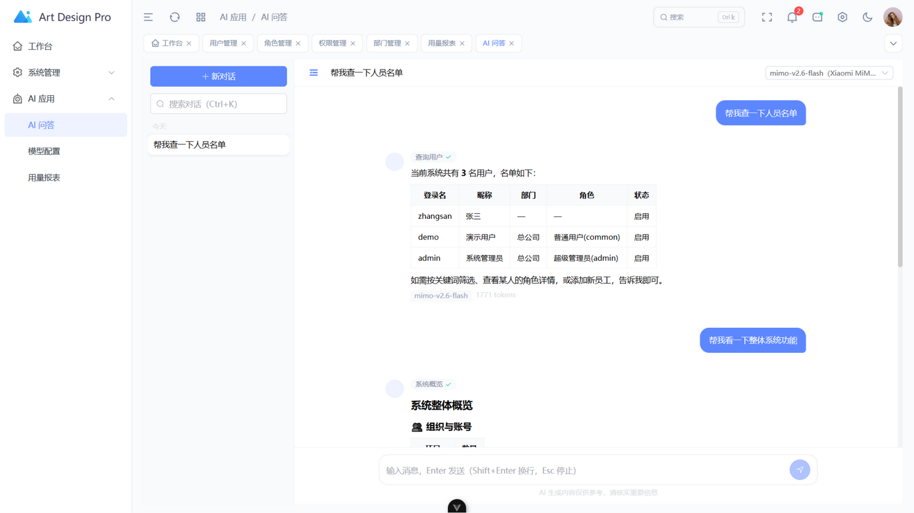 | 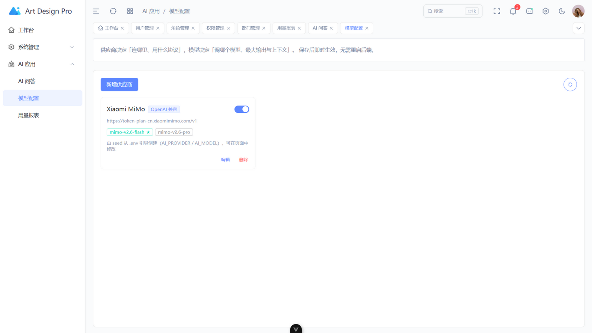 | 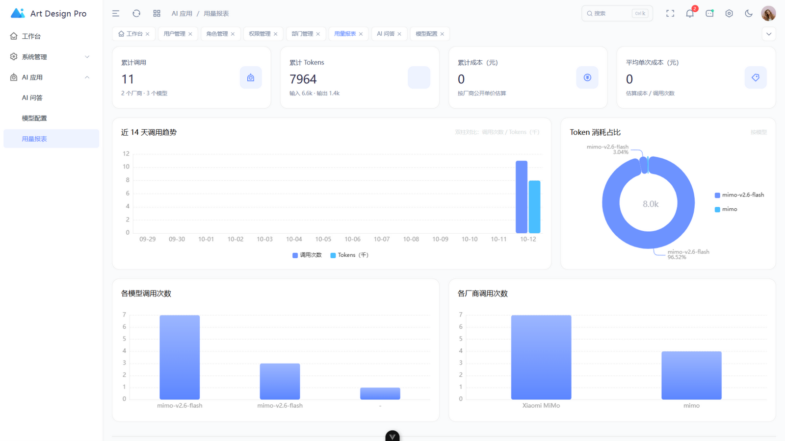 |
| **登录（含注册 / 找回入口）**              |                                               |                                              |
| 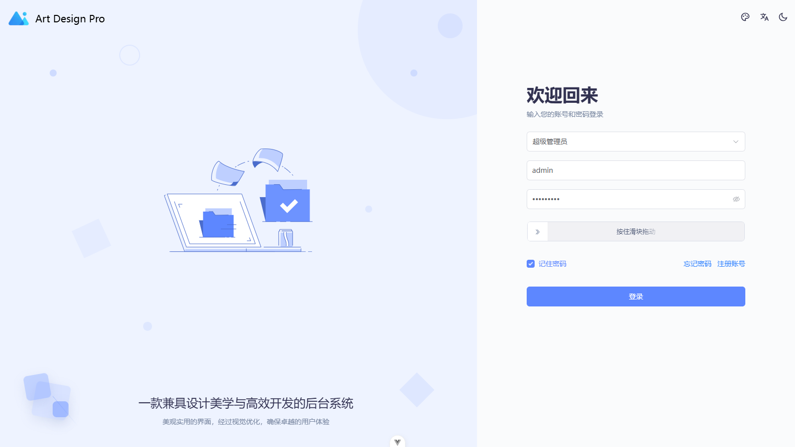 |                                               |                                              |

</details>

## 架构

```
┌────────────────────────────────────────────────┐
│ Controller（接入层：路由/SSE/参数解析，零业务）    │
├────────────────────────────────────────────────┤
│ Service（应用层：用例编排、事务边界）             │
├────────────────────────────────────────────────┤
│ Prisma schema（领域层：唯一事实来源）            │
├────────────────────────────────────────────────┤
│ infra（基础设施：prisma/redis/logger/ai，可替换） │
└────────────────────────────────────────────────┘
        Vue3 管理端（web/ :3006）── /api/v1 ──→ NestJS（:3000）
```

依赖单向向下：`Controller → Service → Prisma`；业务模块之间通过事件通信；AI 能力只经 `infra/ai` 门面暴露，业务代码禁止直连厂商 SDK。

## 技术栈

| 领域      | 选型                                                                                    |
| --------- | --------------------------------------------------------------------------------------- |
| 后端      | NestJS 11 · TypeScript 5（strict）· Prisma 6 · PostgreSQL · Redis 7                     |
| 认证鉴权  | @nestjs/jwt 双 Token · argon2 · 自研权限码 RBAC · @nestjs/throttler                     |
| AI        | LangChain 1.x（createAgent）· @langchain/openai · @langchain/ollama · SSE · 用量审计    |
| 日志/文档 | nestjs-pino（结构化 JSON + traceId）· @nestjs/swagger                                   |
| 前端      | Vue 3 · Vite · Element Plus · Tailwind CSS 4 · Pinia · axios 统一封装（`@/utils/http`） |
| 工程化    | pnpm · ESLint 9 flat · Prettier · Stylelint · husky + commitlint · Jest · Docker        |

## 快速开始（前端 + 后端）

```bash
# 0. 克隆后先复制环境文件（.env.* 不入库，变量模板见 .env.example）
cp .env.example .env.development

# 1. 安装依赖
pnpm install

# 2. 启动基础设施（PostgreSQL + Redis）
docker compose up -d

# 3. 初始化数据库（迁移 + 种子数据）
pnpm prisma:migrate      # 首次执行（自动加载 .env.development）
pnpm prisma:seed         # 初始化权限树 + admin/demo 账号 + 通知/模型配置样本

# 4. 启动后端（或 VS Code 按 F5 断点调试）
pnpm dev

# 5. 启动前端（另一个终端）
cd web && pnpm install && pnpm dev   # http://localhost:3006
```

- 接口文档：<http://localhost:3000/api/docs>
- 健康检查：<http://localhost:3000/health>、<http://localhost:3000/ready>
- 前端页面：<http://localhost:3006>（登录后自动按权限生成菜单）
- 内置账号：`admin / Admin@123`（超管，全部菜单）、`demo / Demo@123`（普通用户，仅工作台 + AI 问答）
- 租户自助注册：登录页「注册账号」→ `/auth/register`（开通租户 + 管理员）；忘记密码页引导联系平台管理员重置
- C 端体验：挂件演示页 <http://localhost:3006/widget-demo.html>；帮助中心 <http://localhost:3000/help/demo-shop>（本地演示 Key `sk-local-demo-001`）

> 没有 Docker？本地装好 PostgreSQL 16 与 Redis 7，修改 `.env.development` 中的连接串即可。
> 没有 AI 密钥？默认 `AI_PROVIDER=mock`，本地模拟应答，链路完整可联调。

## 常用命令

| 命令                                               | 说明                                                 |
| -------------------------------------------------- | ---------------------------------------------------- |
| `pnpm dev`                                         | 后端开发模式（热重载，:3000）                        |
| `pnpm start:debug`                                 | 调试模式（9229 端口，配合 VS Code F5）               |
| `pnpm build`                                       | 构建到 dist（自动重写路径别名）                      |
| `pnpm lint` / `pnpm lint:fix`                      | ESLint 检查 / 修复                                   |
| `pnpm typecheck`                                   | TS 类型检查                                          |
| `pnpm test`                                        | 单元测试（无需 DB）                                  |
| `pnpm test:e2e`                                    | e2e 测试（需先起库并 seed，见「测试」）              |
| `pnpm prisma:migrate` / `pnpm prisma:migrate:test` | 开发库 / 测试库迁移                                  |
| `pnpm prisma:seed`                                 | 种子数据（测试库：`NODE_ENV=test pnpm prisma:seed`） |
| `pnpm check:circular`                              | 循环依赖检查                                         |
| `cd web && pnpm dev / lint / build`                | 前端：开发 / 检查 / 构建（含 vue-tsc）               |

## 目录结构

```
src/
├── config/        # 配置中心（Joi 启动校验）
├── infra/         # 基础设施：prisma / redis / logger / ai（Provider 抽象）
├── shared/        # 横切能力：守卫 / 拦截器 / 过滤器 / 装饰器 / 常量 / 缓存服务
└── modules/       # 业务模块：auth / system(用户·角色·权限·部门) / saas(租户·知识库·会话·挂件·帮助中心) / ai-chat(对话+工具调用) / ai-config(模型配置) / dashboard / notification / health
web/               # Vue3 管理端（art-design-pro：api / views / components / hooks）
prisma/            # schema + 迁移 + seed（权限树初始化）
docs/              # 架构设计方案
http/              # REST Client 接口用例（登录/权限/AI 流式）
test/              # e2e 测试
AGENTS.md          # AI 编码代理行为规范与技术约定
.vscode/           # 调试四配置 + 编辑器规范（入库统一）
```

## 权限使用指南

### 后端：给接口加权限

```typescript
@Post()
@RequirePermissions(PermissionCode.SystemUserCreate)   // 引用常量，禁止写字符串
create(@Body() dto: CreateUserDto) { ... }
```

- 未标注接口：登录即可访问；`@Public()`：免登录；超管：全通。
- 列表接口加数据权限：`@DataScope()` + `@DataScopeFilter()` 取 where 片段合并查询。
- 新增权限码：先在 `src/shared/constants/permission-code.ts` 加常量，再在 `prisma/seed.ts` 的 `PERMISSION_TREE` 登记并执行 `pnpm prisma:seed`。

### 前端：按钮与路由控制

`GET /api/v1/auth/profile` 返回 `permissions: string[]` 与 `menus` 树：

```vue
<el-button v-auth="'system:user:create'">新增用户</el-button>
```

- 按钮显隐用 `v-auth` 指令（权限码与后端 `PermissionCode` 同源，禁止前端自造）；
- 菜单树经 `web/src/utils/menu-mapper.ts` 映射为前端路由：后端菜单 path `/system/user` → 组件 `web/src/views/system/user/index.vue`，新增页面须遵循该约定；
- 表格页优先使用模板封装：`useTable` / `useTableColumns` / `ArtTable` / `ArtForm`，请求只走 `@/utils/http`（自动带 Token、401 自动登出、自动解包 `data`）。

权限变更即时生效：管理端调整角色权限后，用户**无需重新登录**（Redis 缓存精准失效）。

## AI 使用指南

### 模型配置（页面可视化，数据库驱动）

登录后在 **AI 应用 → 模型配置** 增删改供应商与模型（协议格式 OpenAI 兼容 / Ollama 可选，模型可设最大输出与上下文窗口），保存即时生效、无需重启；也支持一键从端点拉取模型列表。`seed` 会把 `.env` 的 `AI_PROVIDER / AI_MODEL` 引导为首个供应商配置，env 仅在数据库无配置时兜底：

```bash
AI_PROVIDER=deepseek
AI_API_KEY=sk-xxx
AI_MODEL=deepseek-chat
AI_FALLBACK_MODEL=deepseek-reasoner   # 主模型失败自动降级
```

已内置预设：`mock`（本地模拟）、`openai`、`deepseek`、`qwen`（通义）、`zhipu`（智谱）、`moonshot`、`mimo`（小米 MiMo，本地默认配置）、`ollama`（本地私有化）。

> 本地开发默认使用小米 MiMo：`AI_PROVIDER=mimo`，主模型 `mimo-v2.6-flash`、备用 `mimo-v2.6-pro`（MiMo 为推理模型，回答前会有思考过程，max_tokens 建议 ≥1024；该厂商暂无 embedding 接口）。
> 配置真实厂商后可用 `pnpm test:ai:smoke` 做真实链路冒烟（chat / 流式 / embedding 三项，不进 CI）。

### 调用（业务代码只注入 AiService）

```typescript
const result = await this.ai.chat(userId, { messages: [{ role: 'user', content: '你好' }] });
for await (const delta of this.ai.chatStream(userId, { messages })) {
  /* SSE 分片 */
}
```

每次调用自动落 `ai_call_log`（traceId 关联请求日志、token 用量、成本估算）；管理端报表：`GET /api/v1/ai/usage`。

流式接口：`POST /api/v1/ai/chat/stream`，帧格式：

- `{"delta":"...","done":false}` — 增量文本；
- `{"tool":{"name":"search_users","status":"running"}}` — Agent 工具活动；
- `{"done":true,"usage":{...},"model":"..."}` — 结束帧。

方法为 POST，请用 fetch 流式消费（`EventSource` 仅支持 GET）。

### 工具调用 Agent（AI 操作真实系统）

对话接口内置工具调用循环：模型自动识别意图 → 调用工具（带当前用户权限码门控）→ 结果回喂 → 流式给出最终答案。内置工具：`get_system_overview` / `search_users` / `create_user` / `assign_user_roles` / `list_roles` / `get_dept_tree` / `list_permissions` / `set_role_permissions` / `get_ai_usage`。扩展新工具只需在 `src/modules/ai-chat/ai-tools.service.ts` 增加一个 spec（声明所需权限码 + handler）；Prompt 模板位于 `src/infra/ai/prompts/`。示例：

> 用户：帮我查一下现在有多少用户 → 模型调用 `get_system_overview` → 返回真实数字
> 用户：添加员工张三 → 模型确认后调用 `create_user` → 返回账号与初始密码

## 调试

VS Code 按 F5 选择：

| 配置                 | 用途                           |
| -------------------- | ------------------------------ |
| Debug: Nest App      | 断点调试应用（改代码自动重启） |
| Debug: Jest 当前文件 | 断点调试光标所在测试           |
| Debug: Jest e2e      | 断点调试 e2e                   |
| Attach: 9229         | 附加到进程 / Docker 容器       |

## 测试

- 单元测试与源码同目录（`*.spec.ts`），AI 调用注入 Mock Provider，零外网依赖；
- e2e 需基础设施：`docker compose up -d` 后 `pnpm prisma:migrate:test && NODE_ENV=test pnpm prisma:seed`，再 `pnpm test:e2e`；
- 质量门禁：`pnpm lint && pnpm typecheck && pnpm test` 全绿才可提交（husky 提交时自动执行 lint-staged）。

## 设计文档

完整设计（权限模型、数据表、AI 基础设施、编码规范、实施路线图）详见 [docs/架构设计方案.md](./docs/架构设计方案.md)；AI 编码代理工作约定见 [AGENTS.md](./AGENTS.md)。

## License

[MIT](./LICENSE) © yhemeo613 —— 可自由用于个人及商业项目（复制、修改、分发、闭源集成均允许，保留版权声明即可）。
